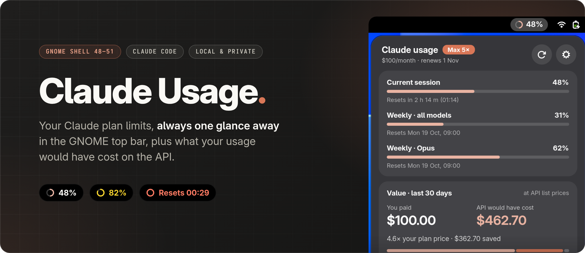
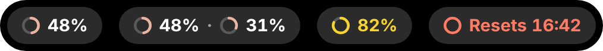
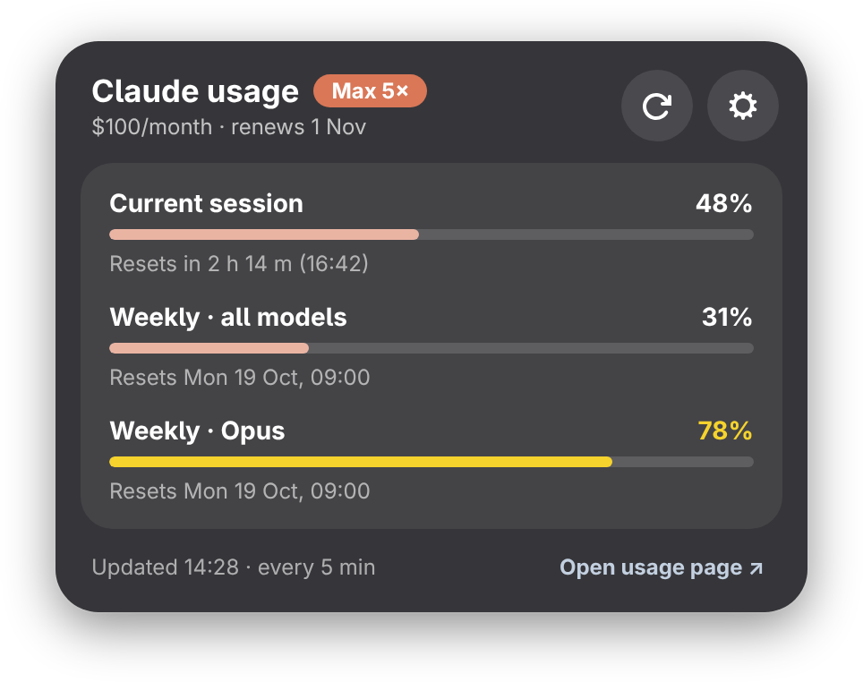
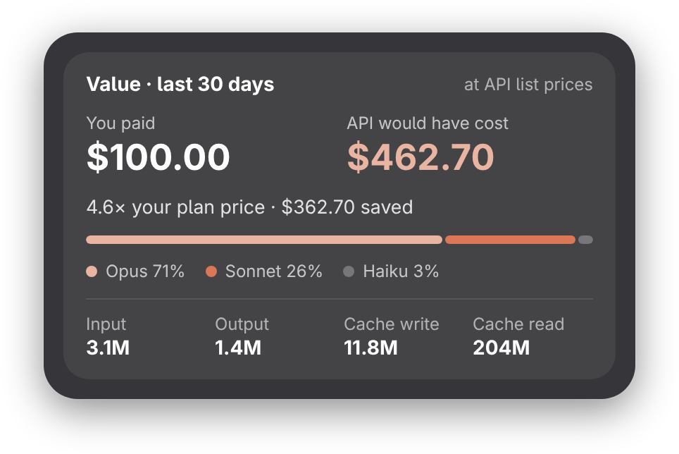
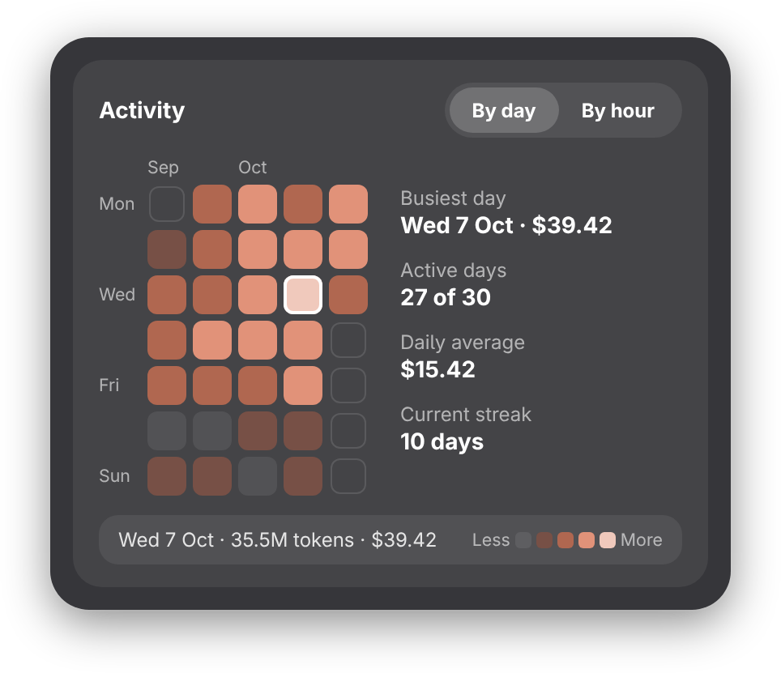
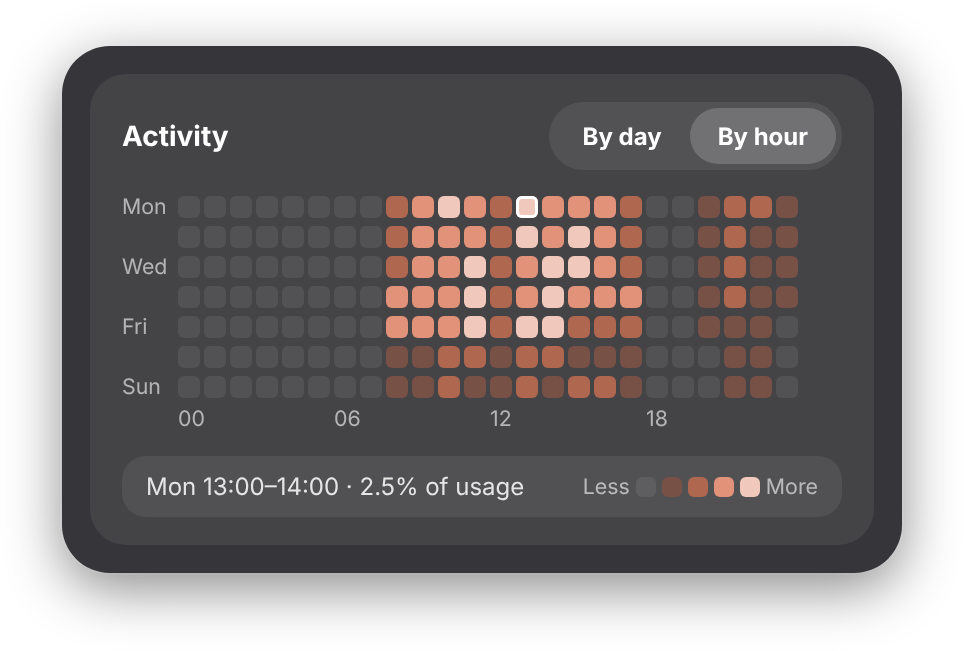
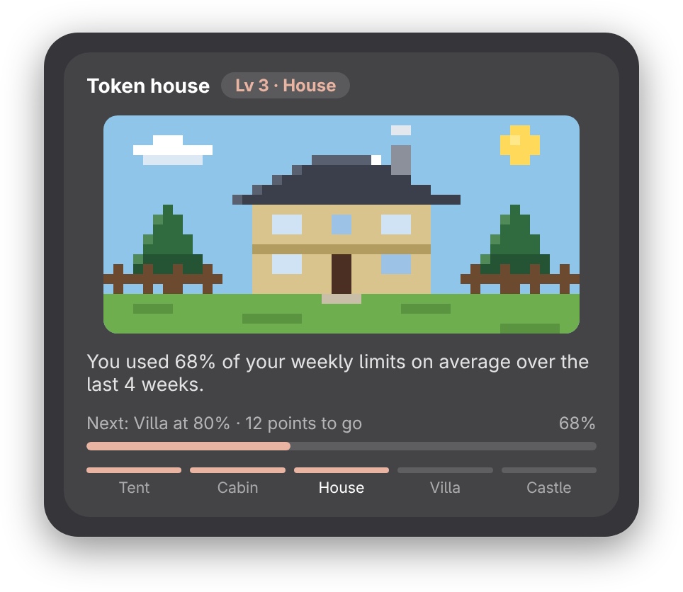

<p align="center">
  
</p>

<p align="center">
  <a href="#"></a>
  <a href="#"></a>
  <a href="LICENSE"></a>
</p>

<p align="center">
  <strong>Know where you stand with your Claude plan, without leaving your desktop.</strong><br>
  Session and weekly limits in the top bar, plus what your usage would have cost on the API.
</p>

<p align="center">
  <a href="#-a-tour-of-the-menu">Tour</a> •
  <a href="#-features">Features</a> •
  <a href="#-install">Install</a> •
  <a href="#%EF%B8%8F-settings">Settings</a> •
  <a href="#-license">License</a>
</p>

---

## 💡 Why Claude Usage?


**Claude Usage** puts it in the top bar. A small ring fills up as you use your plan and turns yellow, then red, as you approach the limit. Click it to see every limit, when each one resets, and how much value you're getting out of your subscription.

<p align="center">
  
</p>

---

## 🧭 A tour of the menu

The menu is built from four sections. Turn any of them off, or drag them into your own order, under **Preferences → Panel**.

<table>
  <tr>
    <td width="50%" valign="top">
      <h3>⏱️ Limits</h3>
      <p>Your current session, the weekly limit across all models, and per-model weekly limits when your plan has them. Each bar shows when it resets and turns yellow at 75% and red at 90%.</p>
    </td>
    <td width="50%"></td>
  </tr>
  <tr>
    <td width="50%" valign="top">
      <h3>💸 Value</h3>
      <p>What your last 30 days of Claude Code would have cost at Anthropic API list prices, against what you paid for your plan. Split by model, with input, output and cache tokens.</p>
    </td>
    <td width="50%"></td>
  </tr>
  <tr>
    <td width="50%" valign="top">
      <h3>🔥 Activity heatmap</h3>
      <p>A GitHub-style calendar of the last 30 days with your busiest day, active days, daily average and current streak. Switch to <strong>By hour</strong> to see when in the week you work with Claude. Hover or click a cell for details.</p>
    </td>
    <td width="50%"><br></td>
  </tr>
  <tr>
    <td width="50%" valign="top">
      <h3>🏠 Token house</h3>
      <p>A little animated pixel-art home that upgrades with how much of your weekly limits you use, averaged over the last four weeks. Start in a tent and put your plan to work to find out what you can build.</p>
    </td>
    <td width="50%"></td>
  </tr>
</table>


---

## ✨ Features

- 🟠 **Live limits in the top bar**: a progress ring and percentage for the most constrained limit, the session or weekly limit, or both side by side.
- 🚦 **Colour-coded warnings**: the ring turns yellow at 75% and red at 90%. When you hit a limit, it shows exactly when the limit resets.
- 🧩 **Your menu, your way**: show only the sections you care about, in the order you want.
- 🔔 **Notifications**: optional alerts when a limit passes your threshold, and when a limit resets.
- 🔐 **No extra login**: uses the session you already have in Claude Code, and you can disconnect it at any time. Your transcripts are read locally and never leave your machine.
- 🎨 **Fits right in**: native GNOME look, Claude-orange accent (or any colour you like), and left, center or right placement.

---

## 📦 Install

**Requirements:** GNOME Shell 48–51 and [Claude Code](https://docs.claude.com/en/docs/claude-code), signed in with your Claude account.

### 1. Clone and install

```bash
git clone https://github.com/naueramant/gnome-claude-usage.git
cd gnome-claude-usage
make install
```

### 2. Log out and back in

On Wayland, GNOME Shell only discovers new extensions when you start a new session.

### 3. Enable it

```bash
make enable
```

The ring appears in your top bar. Click it to open the dashboard.

---

## ⚙️ Settings

Open the preferences from the ⚙️ button in the menu, or run `make prefs`.

| | |
| :--- | :--- |
| **Account** | Sign-in status (connect or disconnect your Claude Code login), plan auto-detection or a fixed plan, a custom monthly price for annual or team billing, a custom Claude Code config directory, and how often to refresh (every 5 min by default, 2 min at the most often, since the usage endpoint rate-limits hard) |
| **Top bar** | Which limit to show, ring and/or percentage, position and accent colour |
| **Panel** | Turn the Limits, Value, Activity heatmap and Token house sections on or off and drag them into your preferred order (or use <kbd>Alt</kbd>+<kbd>↑</kbd>/<kbd>↓</kbd>); animate the token house |
| **Cost** | Currency (USD, EUR, GBP, DKK, SEK or NOK) with your own exchange rate, and whether the heatmap shows cost or tokens |
| **Alerts** | Warn when nearing a limit (threshold 80% by default) and notify when a limit resets |

--- | :--- |
| **Account** | Plan auto-detection or a fixed plan, a custom monthly price for annual or team billing, and how often to refresh (every 5 min by default, 2 min at the most often, since the usage endpoint rate-limits hard) |
| **Top bar** | Which limit to show, ring and/or percentage, position and accent colour |
| **Panel** | Turn menu sections on or off and drag them into your preferred order; animate the token house |
| **Cost** | Currency (USD, EUR, GBP, DKK, SEK or NOK) with your own exchange rate, and the heatmap metric |
| **Alerts** | Warning threshold and reset alerts |

---

## 📄 License

Claude Usage is free software licensed under the [GNU General Public License v2.0 or later](LICENSE).

<sub>Not affiliated with or endorsed by Anthropic. Claude is a trademark of Anthropic, PBC.</sub>
