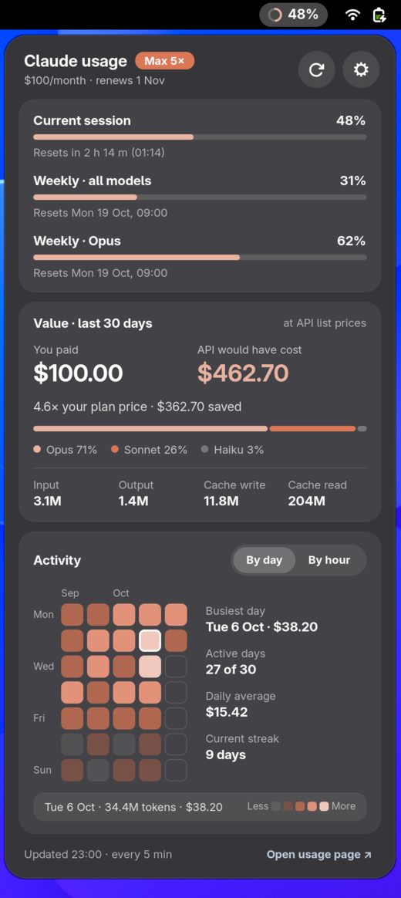
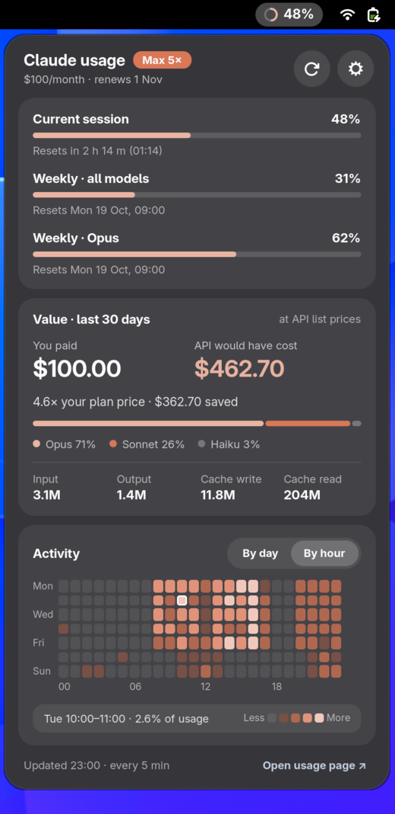

<p align="center">
  
</p>

<p align="center">
  <a href="#"></a>
  <a href="#"></a>
  <a href="LICENSE"></a>
</p>

<p align="center">
  <strong>Know where you stand with your Claude plan, without leaving your desktop.</strong><br>
  Session and weekly limits in the top bar, plus what your usage would have cost on the API.
</p>

<p align="center">
  <a href="#-features">Features</a> •
  <a href="#-install">Install</a> •
  <a href="#%EF%B8%8F-settings">Settings</a> •
  <a href="#-license">License</a>
</p>

---

## 💡 Why Claude Usage?

Hitting your session limit mid-task is the worst way to find out you were close. Checking means opening a browser, finding the usage page and doing the maths yourself.

**Claude Usage** puts it in the top bar. A small ring fills up as you use your plan and turns yellow, then red, as you approach the limit. Click it to see every limit, when each one resets, and how much value you're getting out of your subscription.

<p align="center">
  
  &nbsp;&nbsp;
  
</p>

---

## ✨ Features

- 🟠 **Live limits in the top bar**: a progress ring and percentage for your current session or weekly limit. You can show the most constrained one, or both side by side.
- 🚦 **Colour-coded warnings**: the ring turns yellow at 75% and red at 90%. When you hit a limit, it shows exactly when the limit resets.
- ⏱️ **Every limit, with reset times**: current session, weekly across all models, and per-model weekly limits when your plan has them.
- 💸 **Is your plan worth it?** See what your last 30 days of Claude Code usage would have cost at Anthropic API list prices. This includes cache reads and writes, and is split by model.
- 🔥 **Activity heatmaps**: a GitHub-style calendar by day and a weekday × hour grid. Find your busiest days and hours, active days and current streak.
- 🔔 **Notifications**: optional alerts when a limit passes your threshold, and when a limit resets.
- 🔐 **No extra login**: uses the session you already have in Claude Code. Your transcripts are read locally and never leave your machine.
- 🎨 **Fits right in**: native GNOME look, Claude-orange accent (or any colour you like), and left, center or right placement.

---

## 📦 Install

**Requirements:** GNOME Shell 48–51 and [Claude Code](https://docs.claude.com/en/docs/claude-code), signed in with your Claude account.

### 1. Clone and install

```bash
git clone https://github.com/naueramant/gnome-claude-usage.git
cd gnome-claude-usage
make install
```

### 2. Log out and back in

On Wayland, GNOME Shell only discovers new extensions when you start a new session.

### 3. Enable it

```bash
make enable
```

The ring appears in your top bar. Click it to open the dashboard.

---

## ⚙️ Settings

Open the preferences from the ⚙️ button in the menu, or run `make prefs`.

| | |
| :--- | :--- |
| **Account** | Plan auto-detection or a fixed plan, plus a custom monthly price for annual or team billing |
| **Top bar** | Which limit to show, ring and/or percentage, position and accent colour |
| **Cost comparison** | Currency (USD, EUR, GBP, DKK, SEK or NOK) with your own exchange rate, and the heatmap metric |
| **Notifications** | Warning threshold, reset alerts and refresh interval |

---

## 📄 License

Claude Usage is free software licensed under the [GNU General Public License v2.0 or later](LICENSE).

<sub>Not affiliated with or endorsed by Anthropic. Claude is a trademark of Anthropic, PBC.</sub>
